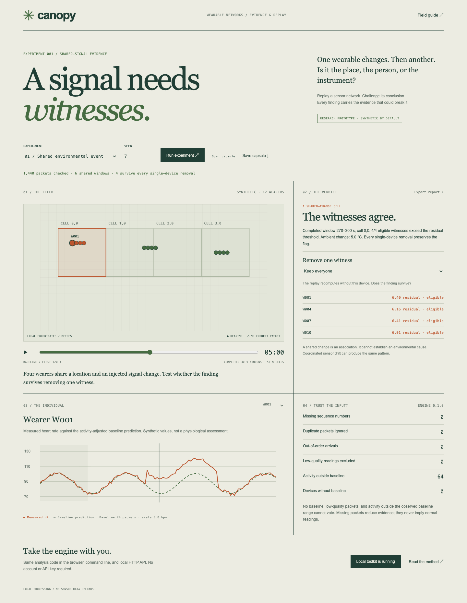

# Canopy

**A signal needs witnesses.** An experimental evidence workbench for shared changes in wearable sensor networks.

Canopy fits an activity baseline for each wearer, looks for agreement among nearby devices, and reruns the decision after removing each witness. A replay lets you inspect what the detector used, why it excluded readings, and where its conclusion breaks.



## Try locally

Download and extract the release toolkit. Install **Node.js 22 or later**, open a terminal in the extracted folder, and run:

```sh
node server.mjs
```

Open **http://127.0.0.1:4435**. Stop with Ctrl+C. No npm install, account, API key, cloud database, or model download is required. If the port is occupied, macOS/Linux: `PORT=4436 node server.mjs`; PowerShell: `$env:PORT=4436; node server.mjs`.

The server listens only on loopback. The hosted replay uses browser-side analysis; the HTTP API is available in the local toolkit. This is a local web application, not a signed native installer or a device firmware package.

## A complete experiment

1. Open the shared-event simulation. Its readings are generated from a seeded linear activity model with an injected change; they are not recordings of people.
2. Scrub the replay. Decisions use the **last completed** time window, so the verdict does not use future packets relative to the playhead. The full individual trace is a retrospective plot.
3. Remove a witness. See whether the finding survives with less support.
4. Try activity-only, one-sensor drift, packet loss, cell-boundary splitting, and coordinated drift.
5. Export an experiment capsule. Reopening it recomputes the analysis from the dataset and settings; saved report text is not trusted.

The implementation includes a browser worker, a shared analysis module, CLI, loopback HTTP API, input validation, packet-quality accounting, seedable stress cases, report/capsule export, reproducible benchmark, and browser tests.

## Programmatic access

```js
import {analyze, simulate} from './dist/core.mjs';
const dataset = simulate({scenario:'shared', seed:7, devices:12});
const report = analyze(dataset);
console.log(report.summary);
```

```sh
node cli.mjs simulate shared --seed 7 --devices 12 --out recording.json
node cli.mjs analyze recording.json --out report.json
node cli.mjs analyze docs/example-capsule.json --out replay.json
```

With the local server running:

```sh
curl http://127.0.0.1:4435/api/analyze \
  -H 'Content-Type: application/json' \
  --data-binary @recording.json
```

The API also accepts `{ "dataset": ..., "settings": ... }`. It rejects cross-origin requests and unexpected Host headers and limits bodies to 10 MiB. It has no persistence or authentication and is intended for a single trusted local operator. Do not expose it to a network or run untrusted programs against it. Dataset processing is batch and in memory.

## Your data

See [the protocol](docs/protocol.md). Device-neutral JSON is supported. There is **no VEX adapter, BLE ingestion, phone app, real-time device connection, clinical inference, or Vexis integration** in this release. Vexis inspired the distributed sensing problem; this project does not claim ownership of Vexis IP or a connection to its hardware.

The browser supports 50,000 samples and 10 MiB per import; the CLI/engine supports up to 500,000 samples and 1,000 devices. The CLI file limit is 100 MiB. Local coordinates, physiological values, and device identifiers are included in exported capsules. Use pseudonyms; no actual wearer records are bundled. No analytics or third-party scripts/fonts are used.

## What distinguishes this prototype

The unit of work is a **challengeable group-level finding**, rather than only an individual trace: per-device baseline support, spatial/temporal quorum, exact single-device-removal checks, and a replayable input-plus-settings capsule. These are implemented features, not a claim that no existing tool has them. See [positioning and prior work](docs/positioning.md).

See [the method and elementary guarantees](docs/method.md). The algorithm is a transparent baseline built from standard regression, robust residual scaling, and quorum rules. No novel statistical method, calibrated uncertainty, causal identification, medical validity, or large-scale field deployment is claimed.

## Validation

```sh
npm test
node scripts/benchmark.mjs --full
```

The full benchmark runs 100 seeds in each of seven scenarios and single scale probes up to 1,000 synthetic devices / 500,000 samples. Raw results, runtime, hardware, and caveats are in [benchmark-full.json](docs/benchmark-full.json). These toy cases share the detector's linear assumptions. Their clean-case scores must not be used as estimates of real-world accuracy. Coordinated drift deliberately demonstrates a causal ambiguity; boundary splitting demonstrates incomplete coverage.

Optional browser regression tests require Google Chrome and `@playwright/test` installed as a development dependency:

```sh
npm install --no-save --package-lock=false @playwright/test
node server.mjs
# In a second terminal:
node tests/browser.mjs
```

The tests save screenshots and a synthetic capsule to `docs/`. Only Chrome has been checked. Figma tooling was unavailable because of the existing account quota; the interface was authored directly in HTML/CSS.

## Develop further

[The validation plan](docs/validation-plan.md) separates simulation, device replay, controlled bench tests, and consented field research. Future work includes adaptive spatial neighborhoods, uncertainty calibration, a workload-matched control group, correlated-error models, device-clock synchronization, and streamed storage. These are planned, not shipped.

Built for Rishit Pradhan's portfolio with AI-assisted implementation. MIT licensed. Benchmark results document software behavior; they do not imply peer review, a validated medical product, or deployment with real personnel.
